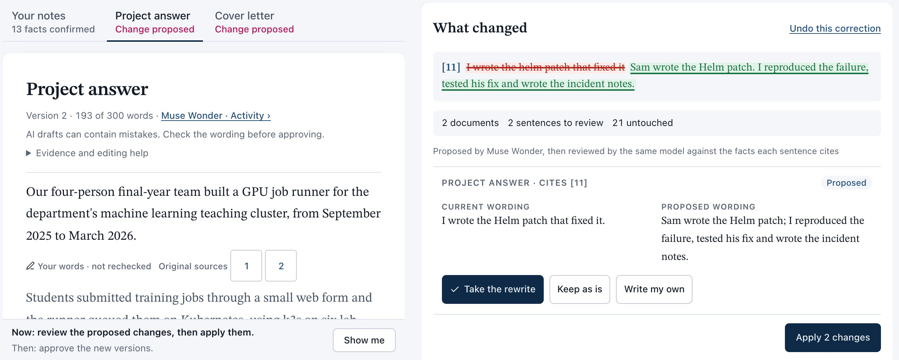
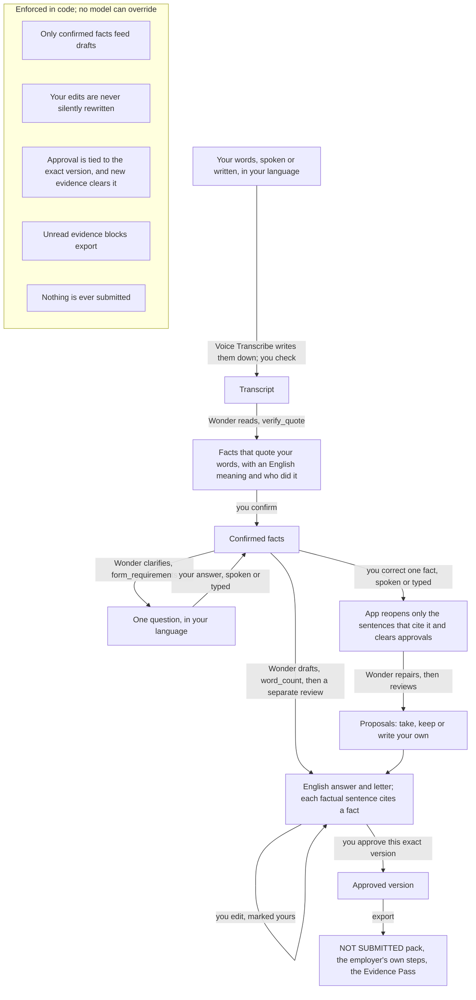

# ApplyArc Evidence

**Say what you did, in your own language. Every factual sentence the app writes cites your exact spoken words, checked by code against the transcript you reviewed, so you can defend it at interview.** A real council advert says: "Using AI? Please follow our guidance to ensure your application reflects your own knowledge and experience." Ana, a fictional care worker, answers it in Portuguese, and every factual English sentence opens her own words. Fix one fact once, and only the sentences that cited it reopen, in both documents. Built for applicants, not employers: it never screens, scores or ranks anyone, and it never submits anything.

| | |
|---|---|
| **Watch** | [The 2:56 film, with English subtitles](https://youtu.be/l3Fjn1Sp0vE), recorded on the live links at the final build `3ee23f2`. The founder speaks every line. Ana is fictional; her voice is synthetic and labelled on screen. |
| **Try it live with Ana** | [Open the demo](https://applyarc-evidence.jollystone-892bee18.northeurope.azurecontainerapps.io/) and press **Try it with Ana's voice note**: her Portuguese clip goes to Muse Voice Transcribe live, and Muse Wonder does the rest (about two minutes of model time; 122 to 144 s end to end in five of six scripted runs, 134 s of them on the live link; the sixth took 371 s because its first reading step took 207 s over five attempts). Short on time? **Start at Ana's key moment** shows the correction live in about a minute. No sign-in; synthetic data only; every walk-through step is tagged "Synthetic voice, fictional applicant · nothing is submitted" ("Fictional applicant" when she starts from her written note). [Judge path](#judge-path). |
| **Try it on open weights** | **Built with Muse Spark Open**, the weights Meta released on 15 October 2026: [the open-weight edition](https://applyarc-evidence-open.jollystone-892bee18.northeurope.azurecontainerapps.io/), the same checks served through Modal (US West). Spoken notes are off there: press **Try it with Ana's written note**, and the screen says so. At her key moment Spark Open sometimes reads her correction as new facts; the screen says so, and **Correct this fact** makes the correction in one click ([what the tests found](#open-weight-edition)). |
| **Who pays** | Proposed buyers are councils and care employers, who would fund free access for applicants; willingness to pay is not yet tested. They need applications in the applicant's own words. The applicant never pays, and the employer never screens, scores or ranks anyone with it. This is the plan: no customers, pilots or revenue yet. [Business case](#business-case-who-pays). |
| **Prizes entered** | Startup track. Best Build on Meta Open Weight Models: [where Muse Spark Open runs, with Modal's request ids](#open-weight-edition). Best Agentic Use-Case: [one full agent trace](#best-agentic-use-case-one-full-trace). |
| **No key needed** | `pnpm install --frozen-lockfile && pnpm check && pnpm start`, then the [fixture path](#no-key-fixture-path) (hand-written outputs, labelled on screen). 1,270 tests in 204 files. |
| **How Meta is used** | `muse-voice-transcribe-1.0` (Meta Model API) hears her; `muse-wonder-1.0` (Meta Model API, Responses API) reads, asks, drafts, reviews and repairs, calling the app's own `verify_quote` as a native tool inside its stream and citing fact ids from a per-call enum, and a second Wonder call reviews every sentence; `meta-models/Muse-Spark-Open-816B-A42B` (Modal) runs every model step on the open-weight link. No model outside Meta's runs in the app. [Details](#how-meta-is-used). |
| **Measured** | 6 of 6 scripted Portuguese journeys on Muse Wonder on 3 November reached the NOT SUBMITTED export, the last on the live link at `a859bf8` (private repo commit): 130 of 130 quotes checked word for word, the one question asked in Portuguese each time, the contradiction caught, 2 sentences reopened, **Verify this run** holding on every check that applies, an estimated model cost of $0.39 to $0.47 a journey. 3 of 3 full journeys on Muse Spark Open through Modal (3 November once, 4 November twice; $0.10 to $0.13, estimated using Muse Spark 1.3 prices as a proxy). Transcription on her synthetic voice: 3.8% to 8.8% word error on the 59-second notes clip; 0% to 5.9% on the two short clips, except 17.6% on the correction in the live-link run, which repeated three words. [Every run and failure](#what-the-tests-found). |
| **Built during the event** | ApplyArc, a UK job-search startup, existed before the hackathon. Everything in this repository was built from 26 October 2026: [provenance](PROVENANCE.md) and the [build log](BUILD-LOG.md). |

## The problem, and the council's line

North Yorkshire Council is recruiting a Care and Support Worker at Kirkwood Hall, Leyburn: a public advert posted 3 November 2026 and closing 16 November, captured on 3 November 2026 at 19:09 UTC with its job description and the council's application advice, and used without partnership (the welcome screen says "a public advert, not a partner or endorser" beside the citation). The advert says: "Using AI? Please follow our guidance to ensure your application reflects your own knowledge and experience". The council's advice page says the panel gives the "supporting evidence" section most attention, asks applicants to "make sure the final application reflects your personal experience and skills", and adds: "We value authenticity." The job description lists ten person-specification points and says accurate spoken English is essential for the post.

Ana is fictional. She has three years in a Leeds care home. She speaks working English every shift and writes the daily notes in English. The hard part is the formal written statement: her evidence, in English, against ten points. So she says it in Portuguese.

In England and Wales, 5.1 million people (8.9%) have a main language other than English, and 880,000 could not speak English well ([ONS, Census 2021](https://www.ons.gov.uk/peoplepopulationandcommunity/culturalidentity/language/bulletins/languageenglandandwales/census2021)). Since 22 July 2025, care employers can no longer recruit care workers from overseas ([gov.uk, 1 July 2025](https://www.gov.uk/government/news/major-immigration-reforms-delivered-to-restore-order-and-control)), so they recruit people who are already here. Employers are also pushing back on AI-written applications: 75% of UK employers that monitor candidates' use of AI have rejected candidates for it ([CIPD, September 2026](https://www.cipd.org/uk/knowledge/reports/resourcing-surveys/)), and 76% of 1,000 US hiring managers say AI-written CVs make it harder to understand what a candidate actually did ([Resume Genius, January 2026](https://resumegenius.com/blog/job-hunting/hiring-insights-report)).

In adult social care in England, 96,000 posts were vacant in 2025/26 ([Skills for Care, The state of the adult social care sector and workforce in England, published 14 October 2026](https://www.skillsforcare.org.uk/Adult-Social-Care-Workforce-Data/workforceintelligence/Reports-and-visualisations/National-information/The-State-of-report.aspx), executive summary).

The council asked for her own knowledge and experience. She said it in Portuguese, and every factual English sentence opens her own words.

| The problem | What applicants do today | What ApplyArc Evidence does | Evidence |
|---|---|---|---|
| Her words are in Portuguese; the form wants written English | Write it alone, or paste a translation into a chat assistant and check every claim | Facts quote her exact Portuguese, checked by code against the transcript she reviewed, each with an English meaning (a working translation) she confirms | 130 of 130 quote checks word for word in six scripted runs on 3 November, one of them on the live link |
| Notes say "we"; the form asks what *you* did | Rewrite it by hand | Each fact carries who did it (Ana, the team, someone else), which she confirms; a sentence that says "I" must cite a fact she did herself | Enforced in code; the drafts kept "we, the whole team, moved dinner earlier" apart from "I made the cards" in every run |
| One fact turns out to be wrong | Re-prompt, then re-read every document | Say it once: only the sentences that cite it reopen, in both documents, with a proposed rewrite beside each | 2 sentences reopened and 0 untouched sentences changed, in all six runs |
| Approved text can drift | Nothing ties an approval to a version | Approval binds to the exact version, and new evidence clears it | Enforced in code and covered by the test suite |
| Employers can't tell what a candidate actually did | A CV line and an interview | The Evidence Pass: one page where every factual sentence opens her Portuguese words and their English meaning, and the footer says what AI drafted | Built; a self-contained page with no external loads, stamped NOT SUBMITTED, with a "Demo: fictional applicant" line on sample runs |
| Tools that apply on your behalf | Bots that mass-apply | Never submits: the export is stamped NOT SUBMITTED and lists the council's own steps | There is no submit path in the code |

## Business case: who pays

**Who pays:** councils and care employers who need applications in the applicant's own words. **Why:** their adverts already ask for it (the council above: "Using AI? Please follow our guidance to ensure your application reflects your own knowledge and experience"); they recruit people whose first language is not English into posts that need filling (96,000 vacant in adult social care in England in 2025/26, Skills for Care); and the Evidence Pass gives a recruiter one page where every factual sentence opens the applicant's own words, without anyone being screened, scored or ranked. Employers and careers services that must say where an applicant's words go can run the open-weight edition on a host they choose. **The applicant** uses it free and stays in control: nothing is ever submitted for them.

**What exists:** ApplyArc, a UK job-search startup that existed before the hackathon, and this evidence engine, built during it. **What is not proven:** no customers, pilots, prices or revenue; willingness to pay, procurement and languages other than Ana's European Portuguese with English care terms are untested.

## Judge path

**About "Verify this run".** It runs seven checks by code, with no model call. On Ana's runs the seventh, sentences in her own wording, has nothing to check, so the screen shows it grey: 6 green and 1 grey is the best result there. On the key-moment route the export check turns green once you open the application. Older results below that say "7 of 7" count that grey check as holding. **Visited before?** Each browser keeps its own workspace for 7 days; press **Start again** for a fresh one.

**Coverage after a correction.** The film was recorded on the final build `3ee23f2` and shows the evenings-and-weekends requirement staying **Needs review** after Ana's correction. An earlier build (`541283d`) kept a requirement covered after the fact behind it changed, although the corrected fact no longer mentions weekends; from `6fa948a` such a requirement stops counting as covered, and from `3ee23f2` the model cannot cover it with another fact either: it stays **Needs review** until the applicant answers its question, and the application lists it if she skips it.

**Ana's key moment (about a minute).** Open the [live demo](https://applyarc-evidence.jollystone-892bee18.northeurope.azurecontainerapps.io/) and press **Start at Ana's key moment**. Her facts are confirmed and both documents approved, prepared from a real Muse Wonder run on 3 November (22:03 to 22:08 UTC) whose transcript was checked first, with misheard words fixed as the check screen asks; the screen says so, and a visitor is never charged for that run. Press **Use Ana's spoken correction**: her clip ("Correção: os turnos da noite foram dois anos, não três; no último ano passei a fazer dias.") goes to Muse Voice Transcribe, and her words come back for you to check. Press **Add Ana's note**. Wonder reads it against her confirmed facts, flags the contradiction itself and asks which is right, in Portuguese with the English beneath. Choose **Use this correction**. **What changed** shows the old fact struck through and the correction in its place: the app reopens only the two sentences that cite it, one in each document, and clears both approvals. Wonder proposes a rewrite for each and its own review checks them. **Take the rewrite** (or **Keep as is**, or **Write my own**), **Apply 2 changes**, approve both documents, and the finish screen lists what just happened. Press **See the application** (stamped NOT SUBMITTED, with the council's own steps still to do), **Download Evidence Pass**, then **Meta activity** and **Verify this run**: seven checks run on your own workspace without calling a model. Measured: 25.8 s and $0.07 through the API when the state was saved (3 November, 22:09 UTC); 23.1 s and $0.07 through the API on the live link at `a859bf8`, the contradiction asked in Portuguese (23:58 UTC); and 47 s to the Evidence Pass in a phone-sized browser on the live link at `d87dd35`, which has the same prepared state. Her three years in the care home (fact 1) stay; the correction changes fact 19, how many of those years were nights: two, not three. The finish screen runs **Verify this run** by itself, so the result is in view at the end of this route too.

**Ana's full journey (about two minutes of model time; allow a few more to read and confirm).**

1. **Try it with Ana's voice note.** Her 59-second clip goes to Muse Voice Transcribe as the screen opens. Her words come back in Portuguese for you to check; fix any word it misheard. If Voice Transcribe repeated a word, the screen names each repeat and **Remove the repeats** takes them out in one tap; it is never done silently, and the app never changes her Portuguese otherwise.
2. **Read Ana's words.** Wonder reads them into facts and calls `verify_quote` on each; the screen counts the checks. Each fact card shows her Portuguese quote, "In English (working translation)" beneath it, and who did it. **Confirm the remaining**.
3. The app checks her facts against the council's ten points (`form_requirements`) and finds the one her words don't cover: equality, dignity and respect. Wonder asks, in Portuguese, with "In English:" beneath. Press **Use Ana's spoken answer** (her 16-second clip), or type it, or press **Speak instead** and say it yourself. Then **Answer**, and confirm the new facts.
4. **Write her application.** Wonder drafts the supporting evidence and a short cover letter, in English, in parallel; a separate Wonder review checks each cited sentence against her Portuguese words. Tap any superscript number to see her exact words and their English meaning.
5. **Next: correct one fact** leads to the key moment above: **Use Ana's spoken correction** (her 7-second clip), **Add Ana's note**, **Use this correction**, take the rewrites, apply, approve.
6. **See the application** (NOT SUBMITTED), **Download Evidence Pass**, then **Meta activity**: every model step with its model, host, effort, tokens, cached tokens, timing, cost and Meta's request ids; every check the app ran; every decision you made. **Download the trace (JSON)** to keep it, and **Verify this run** to re-check the record by code.

**Ellie, one click away.** Ellie is a fictional graduate answering Graphcore's real form (public snapshot, 26 October 2026; not a partnership) in English. Her card offers **Start at the key moment** (her facts and both documents prepared from a real Muse Wonder run on 3 November, 16:03 to 16:05 UTC; add her note, choose the correction, take the rewrites: 45 s from opening the page to the finish screen in a browser on the live link on 3 November, 31 s and $0.12 through the API, and 47.3 s and $0.13 through the API on the live link at `a859bf8`) and **Try it with Ellie's notes** (about five minutes; type or speak the answer `I wrote the Helm patch that mounted a memory-backed emptyDir with a size limit per job.`, then add the note `Sam wrote the Helm patch. I reproduced the failure, tested his fix and wrote the incident notes.`).

The live model varies its wording and its question; answer from the fictional facts on screen and don't invent details. If Meta is busy, press **Try again**. Visitor workspaces are separated by cookie, which is not private authentication, so use synthetic notes only. Each visitor's live spend has a hard ceiling.

**With your own key** ([run from this repository](#run-from-this-repository)), the same path works, and you can say Ana's words yourself with **Speak instead** or paste them:

- Her notes: `Chamo-me Ana. Eu trabalho há três anos num lar em Leeds; comecei em outubro de 2023. Tenho a formação da medicação e faço a medication round da manhã para 18 residentes. No fim do turno, escrevo as daily notes em inglês e assino a folha da medicação. Antes do turno, leio o care plan de cada residente e faço o que lá está. Tenho a formação de moving and handling, uso a grua e trabalhamos sempre em dupla. Na unidade de demência, os residentes ficavam agitados ao fim do dia, por isso nós, a equipa toda, passámos o jantar para mais cedo. Eu fiz cartões com fotografias da comida, para cada pessoa poder apontar o que quer comer. Fiz três anos de noites, e também fins de semana. Uma noite, vi uma nódoa negra no braço de uma residente. Registei e contei logo à enfermeira de serviço, e ela fez a participação de safeguarding.`
- Her answer: `Para mim, dignidade é bater à porta antes de entrar, explicar o que vou fazer antes da higiene pessoal e fechar sempre as cortinas. E respeito a cultura e a religião de cada pessoa: pergunto o que quer comer, como quer ser tratada e se prefere ser ajudada por uma mulher.`
- Her correction: `Correção: os turnos da noite foram dois anos, não três; no último ano passei a fazer dias.`

## No-key fixture path

Fixture outputs are hand-written and labelled on screen; they are not Meta output. This is also what runs if the demo's live allowance is used up.

**Ana:** **Try it with Ana's written note** (the card says "typed, not spoken") **→ Read Ana's words → Confirm the remaining →** the question **→ Use Ana's sample answer → Answer →** confirm **→ Write her application → Next: correct one fact →** type her correction (the fixture stands in with hand-written rewrites) **→ Apply → approve both documents → See the application → Download Evidence Pass.**

**Ellie:** **Try it with Ellie's notes → Yes, confirm → Confirm the remaining → Use Ellie's sample answer → Answer → Confirm the remaining → Write her answer → Review and finish → Try Ellie's correction → Save the correction → Apply 2 changes → approve both documents → Preview the export.** Adding a new note needs the live model.

## What happens when a fact changes

Ana answers the council's supporting-evidence section:

1. She says it in Portuguese. Muse Voice Transcribe writes it down; she checks the words before anything else happens.
2. Wonder reads her words into facts. Each quotes her exact Portuguese, checked by code against the transcript she reviewed, with an English meaning (a working translation) and who did it. She confirms both.
3. The app finds the one point her words don't cover. Wonder asks her, in Portuguese; she answers out loud. Two documents are drafted in English, and every factual sentence cites a confirmed fact. A separate Wonder review checks each cited sentence against her Portuguese quote, its English meaning and who did it; the app keeps only what passes and holds the rest for her.
4. She approves both documents. Approval is tied to that exact version. Anything she writes herself is marked as hers and never rewritten without asking.
5. She remembers: nights were two years, not three. She says it once. Wonder flags the contradiction and asks which is right; she chooses the correction.
6. The app reopens only the sentences that cite the changed fact (2 sentences across both documents in each of six scripted runs; 0 untouched sentences changed) and clears both approvals. Wonder proposes a repair for each, current and proposed wording side by side; its own review checks each rewrite. She takes, keeps or rewrites each one, approves the new versions and exports a pack stamped **NOT SUBMITTED**, listing the council's own steps (create the account; the enhanced DBS disclosure).
7. The Evidence Pass gives the employer one page where every English sentence opens her Portuguese words and their English meaning. It is stamped NOT SUBMITTED and, on a sample run, says "Demo: synthetic voice, fictional applicant." ("Demo: fictional applicant." when she started from her written note). Its footer says the sentences were drafted with AI (Muse Wonder 1.0) from words Ana spoke in Portuguese, that each English meaning is a working translation she confirmed, that she approved this exact version, and that it is not a reference check or an assessment of her.

The same mechanism runs Ellie's English path. This frame is from her hosted Muse Wonder run of 3 November:


<sub>Real frame from the hosted Muse Wonder run of 3 November 2026. Ellie is a fictional graduate; the Graphcore form is a public snapshot (26 October 2026; not a partnership).</sub>

## How Meta is used

| Meta model | Model ID | Where it runs | What it does here |
|---|---|---|---|
| Muse Voice Transcribe 1.0 | `muse-voice-transcribe-1.0` | Meta Model API (`api.meta.ai/v1/asr/transcribe`) | Turns her spoken notes, her spoken answer and her spoken correction into text she checks (main link only) |
| Muse Wonder 1.0 | `muse-wonder-1.0` | Meta Model API, Responses API (`api.meta.ai`) | Every agent step on the main link: reading words into facts, checking the form, asking in her language, drafting, reviewing, repairing |
| Muse Spark Open | `meta-models/Muse-Spark-Open-816B-A42B` | Modal, US West, chat completions | Every agent step on the open-weight link |

No model outside Meta's runs in the app; Muse Spark 1.3 is also supported (the default when `META_MODEL` is unset) and neither live link uses it. Every receipt records the model and the host. Each Wonder and Spark Open step also records the provider's request ids; each voice receipt records the model, the host, the language hint and the keywords sent. **Download the trace (JSON)** in Meta activity gives you all of them. When both Voice Transcribe and Wonder ran, the trail also says how new they are: Meta introduced Muse Voice Transcribe in a post dated 3 September 2026 and Muse Wonder in a post dated 12 October 2026; the Muse Spark Open weights were released on 15 October 2026.

Muse Voice Transcribe takes one file call per clip, with a Portuguese language hint and, for the bundled samples, Meta's `keywords` for her name and her town (`Ana`, `Leeds`, `Chamo-me Ana`); your own recordings send no keywords. Muse Wonder runs every agent step through the Responses API: reading the Portuguese transcript into proposed facts, each with a verbatim quote, a short English meaning and a who-did-it tag; checking the form's requirements; asking the one question in her language; drafting both documents in English; reviewing each English sentence against the fact it cites; and proposing and re-checking repairs after a correction. Each step is a bounded agent loop. Muse Spark Open runs the same agent on open weights through Modal.

Ana's run of 3 November 2026, 21:40 to 21:42 UTC. Every step, as its receipt recorded it:

| Step | Meta model | What it did | Model time | Cost |
|---|---|---|---:|---:|
| Hear her notes | Muse Voice Transcribe 1.0 | 59.0 s of Portuguese into text she checked; hint Portuguese; keywords Ana, Leeds, Chamo-me Ana | 15.3 s | $0.0029 |
| Read her notes | Muse Wonder 1.0, effort low | Proposed 12 facts; `verify_quote` 12 of 12 word for word; 9,235 input tokens, 4,712 of them cached | 18.0 s | $0.068 |
| Check the form | Muse Wonder 1.0, effort low | `form_requirements`; found the one point her words don't cover and asked it in Portuguese, English beneath | 11.6 s | $0.027 |
| Hear her answer | Muse Voice Transcribe 1.0 | 16.2 s of speech into text she checked | 4.3 s | $0.0008 |
| Read her answer | Muse Wonder 1.0, effort low | 7 more facts; `verify_quote` 8 of 8 word for word | 15.0 s | $0.040 |
| Draft both documents | Muse Wonder 1.0, effort medium | Supporting evidence (206 of 500 words) and cover letter (178 of 350), in parallel, with `word_count` | 12.3 s and 14.8 s | $0.112 |
| Review the drafts | Muse Wonder 1.0, effort medium | 31 cited sentences against their facts: 31 supported, 0 held back | 6.6 s and 8.9 s | $0.076 |
| Hear her correction | Muse Voice Transcribe 1.0 | 7.2 s of speech into text she checked | 2.8 s | $0.0004 |
| Read her correction | Muse Wonder 1.0, effort low | Flagged the contradiction and asked which is right, in Portuguese; `verify_quote` 2 of 2 | 9.1 s | $0.026 |
| Repair, then review | Muse Wonder 1.0, effort medium | Proposed the two rewrites ("I did two years of night shifts, and in the last year I moved to doing days."); the review passed both | 6.3 s and 4.6 s | $0.043 |
| **Total** | **10 Wonder steps, 3 voice calls** | **28 tool calls: `verify_quote` 22, `form_requirements` 4, `word_count` 2** | **129.5 s** | **$0.397** |

Costs are token-priced estimates at list prices, not invoices. The scripted driver's end-to-end time was 129 s and its cost $0.401, because it made three extra transcription calls as controls. **Verify this run** at the end: 19 of 19 confirmed facts quote Ana's text word for word; 31 of 31 drafted statements cite at least one confirmed fact; 31 of 31 state no number their cited facts do not; 2 of 2 approvals match the current version; no sentences marked as Ana's own; the export is stamped NOT SUBMITTED and holds exactly the approved versions; the model review is on record. **Start at Ana's key moment** comes from a later run, 22:03 to 22:08 UTC, whose transcript was checked and fixed first ([its receipts](results/ownlang-20261103/live/run-fixed-transcript/report.json)).

| Responses API feature | Where | What it does here |
|---|---|---|
| Native tool calls, in parallel | `server/agent/tools.js`, `loop.js` | Wonder calls the app's own `verify_quote`, `form_requirements` and `word_count`; the app runs them and returns the result inside the stream. `verify_quote` checks a quotation word for word against the transcript after Unicode normalisation, so a Portuguese quote is checked by the same code as an English one. |
| Strict structured output with per-call enums | `server/agent/schemas.js` | Fact and decision ids are enums built from the confirmed facts on every call, so the model cannot cite a fact that does not exist. |
| Streaming | `server/agent/sse.js` | Each tool call appears on screen as it happens. |
| `store: false` with encrypted reasoning | `server/agent/loop.js` | Reasoning travels between tool turns as encrypted content, and the API keeps no conversation state between calls. |
| `prompt_cache_key` per step | `server/agent/loop.js` | Instructions are byte-identical on every call, so much of each step's input is served from Meta's cache (4,712 of 9,235 input tokens on the first Wonder step above). |
| `safety_identifier` | `server/agent/model.js`, `loop.js` | Each visitor is identified to Meta by a hash, never by identity. |
| `Retry-After` and rate-limit headers | `server/agent/transport.js` | Waits are honoured, and receipts record request ids and headroom. |



The model proposes; the app decides what is saved. These are model judgements about the applicant's own account, not proof that the account is true: a word-for-word match proves the quote, not the claim.

Meta's [legal-agent workshop](https://github.com/meta-models/legal-agent-workshop) (Agents 101 and 102) teaches checks the model cannot skip. The same pattern runs here: the record refuses a quote that is not word for word in the source, in any script (`server/domain/facts.js`); the checks sit inside the drafting and repair flows, not in a tool the model may skip (`server/agent/draftFlow.js`, `repairFlow.js`); code rules run before the model judge (`server/agent/evidenceReview.js`); refusals are bounded to one revision, then go back to the applicant; a person signs off, and approval binds to the exact version (`server/domain/review.js`); and **Verify this run** re-checks a finished run by code (`server/domain/verifyRun.js`). Where this app goes further: on Muse Wonder, citations are constrained while the model writes them; on every host, the app refuses a draft that cites an unconfirmed fact before saving it; an unreadable review holds the sentence instead of passing it; and one correction reopens only the sentences that cite it, in both documents, and clears their approvals.

## The language rules: which checks are code, which are the model's, and what Ana confirms

| Check | Done by |
|---|---|
| A quote must appear word for word in her transcript (Unicode NFC, quotes and whitespace normalised; any script) | Code: `verify_quote` inside Wonder's stream, and again before a fact is saved (`server/domain/facts.js`, `text.js`) |
| A sentence may cite only a confirmed fact | Code: fact ids are an enum rebuilt per call on Wonder; on every host the app refuses an unconfirmed citation before saving |
| A digit in an English sentence must come from a cited fact | Code, on every language. For an English fact, the quote's digits or number words; for a Portuguese fact, the digits in the English meaning she confirmed (the prompt keeps them as digits) and in the quote. Code reads Portuguese number words ("três", "dezoito") not at all; the model review reads them (`server/domain/claims.js`, `text.js`) |
| Who did it ("I" against "we") | Code. For English quotes it reads first-person words; for Portuguese facts it uses the actor tag (Ana, the team, someone else) she confirmed with each fact, and a sentence that says "I" must cite a fact tagged as hers (`server/domain/languages.js`, `claims.js`) |
| The English sentence is faithful to the fact (meaning, actor, numbers) | The model: a separate Muse Wonder review reads each cited sentence against the fact's Portuguese quote, its English meaning and who did it; what it refuses is revised once, then held for her |
| The question is in her language | The model asks in Portuguese with English beneath; if it leaves a personal point unasked, the app's own fallback question is in Portuguese too |
| The transcript is right | Ana, before anything else happens; the app never changes her Portuguese |
| The English meaning is right | Ana, when she confirms the fact. It is a working translation, not a certified one; no fluent speaker and no model has reviewed the meanings as translations |
| Approvals bound to versions; only citing sentences reopen; her own wording never rewritten without asking; export cannot submit; Verify this run | Code, unchanged, language-free |

One language is built: European Portuguese (`pt-PT`). The demo supports European Portuguese; other languages have not been validated yet. Polish was probed on the unchanged engine and failed our own bar on place names (below), so it was not built. Meta's post says Voice Transcribe covers 25+ languages; this repository claims what it ran.

## Best agentic use-case: one full trace

One spoken note becomes a cited, checked application pack. The agents decide what to extract, what to ask, what to write, what to hold back and what to reopen; the app's code owns the facts, versions, approvals and export, so no agent can approve or submit anything.

**The trace:** Ana's whole journey on the live link at `541283d`, recorded for the film on 4 November (13:10 to 13:15 UTC): [the trace the run downloaded](results/hosted-20261104/footage/live-7-main-trace.json), stamped `"status": "NOT SUBMITTED"`. 13 model steps (3 Muse Voice Transcribe, 10 Muse Wonder), 24 tool calls (19 `verify_quote`, 3 `form_requirements`, 2 `word_count`), 17 Meta request ids, 129 s of model time, $0.40. Across the six scripted runs on 3 November: 10 or 11 Wonder steps and 26 to 28 tool calls each ([what the tests found](#what-the-tests-found)).

| Step | Agent | What it decides on its own | What the code checks |
|---|---|---|---|
| Hear | Muse Voice Transcribe, with a language hint and keywords | Her Portuguese, with her English care terms kept in English | She checks the words; repeated words are named, never removed silently |
| Read | Muse Wonder, tools `verify_quote` and `form_requirements` | Which facts her words hold: the quote for each, its English meaning and who did it | Each quote word for word against her text, inside Wonder's stream; fact ids from a per-call enum |
| Check | Muse Wonder, `form_requirements` | Which of the council's ten points her facts leave uncovered, and the one question to ask, in Portuguese | The question names a real requirement |
| Draft | Muse Wonder, `word_count` | The supporting evidence and the letter | Every factual sentence cites confirmed facts; no number her facts lack; "I" only for her own actions; word limits |
| Review | A second Muse Wonder call | Whether each sentence is supported by the Portuguese it cites; it can hold sentences back | The review is on the record for **Verify this run** |
| Repair | Muse Wonder | That her correction contradicts a confirmed fact, the question which is right, and new wording for only the sentences that cited it | Only citing sentences reopen; approvals are bound to versions |
| Decide | Ana | Confirms facts and meanings, answers, picks the correction, approves each version | The export is stamped NOT SUBMITTED; **Verify this run** re-checks it all by code, with no model call |

## Open-weight edition

**For the infrastructure partner.** Model `meta-models/Muse-Spark-Open-816B-A42B`, served through Modal's partner inference in US West (chat completions on `adriangeorgem--ep-applyarc-evidence-dev-server.us-west.modal.direct`; the endpoint answers HTTP 401 without the key, checked 4 November). Every Spark Open receipt records the model, the host and Modal's request id:
- [Ana's full journey on the open link at `541283d`, run 1](results/hosted-20261104/live-541283d/spark-full-1/report.json) (4 November, 13:24 UTC): 13 model steps, 13 Modal request ids, 150 s, $0.13 estimated, Verify holding on every check that applies, NOT SUBMITTED.
- [Run 2](results/hosted-20261104/live-541283d/spark-full-2/report.json) (13:27 UTC): 9 model steps, 9 Modal request ids, 131 s, $0.10, Verify holding on every check that applies, NOT SUBMITTED.
- [Ana's full journey on 3 November](results/ownlang-20261103/spark/ana-spark/report.json): 13 Spark Open receipts with Modal request ids.
- [Ana's key moment on the open link at `541283d`](results/hosted-20261104/live-541283d/open-km/) (browser at 1440 px): Spark Open flagged the contradiction itself, in Portuguese; she kept the earlier account; **Correct this fact** reopened 2 sentences across both documents and left 40 untouched; Verify holding on every check that applies; 3 model steps, $0.024. The three attempts before it are kept beside it: the first two stopped on the test script's side (it pressed **Keep the earlier account** again while the card was closing), the third passed Verify holding on every check that applies and then stopped on a script screenshot.
- Modal's own billing page, 4 November: $2.41 of Modal credit used in November, billed as LLM tokens; the keep-warm ping is one 1-token request every 4 minutes.


**Built with Muse Spark Open.** The same code runs on Meta's open-weight **Muse Spark Open** (`meta-models/Muse-Spark-Open-816B-A42B`) through Modal's partner inference: https://applyarc-evidence-open.jollystone-892bee18.northeurope.azurecontainerapps.io/ . Reading, checking, drafting, review and repair all run there, not on Meta's API. Spoken notes run on Meta's API only, so on this link the card offers **Try it with Ana's written note** and says why; **Start at Ana's key moment** reuses the state prepared on the Muse Wonder link (the screen says so), and her written correction, its reading and the repair run on Muse Spark Open. Modal's endpoint rejected native tools combined with strict structured output, so this edition uses structured chat and the app runs every check itself; a keep-warm ping keeps the endpoint ready between visitors (warm-up HTTP 200 in 1.2 s on 3 November). It matters because a care employer or an employability service has to decide where a vulnerable adult's words go; with open weights it could run the model where it chooses. This demo's model calls go to Modal in US West, and no institution has deployed it. Muse Spark Open's usage policy and model card say it is not intended for under-18s, so this edition is for adults.

Ana's journey on Muse Spark Open, 3 November, from this repository's code: 13 facts from her written note, 20 of 20 confirmed facts word for word by the app's own check (no native tool calls on this host), both questions in Portuguese (one from the model, about the dementia unit, which the script skipped; the dignity point asked by the app's own Portuguese question), both documents drafted and reviewed, the review held 1 sentence back and the loop revised before she saw anything, a typed correction, 1 sentence reopened (the letter had not cited that fact and stayed approved), Verify holding on every check that applies, NOT SUBMITTED: 13 model steps, 47 s end to end, $0.13 estimated at Muse Spark 1.3 prices (Modal bills its own credits; [its 13 model receipts with Modal request ids](results/ownlang-20261103/spark/ana-spark/report.json); the app ran on a local server, every model step on Modal). Earlier, on the English path, Muse Spark Open caught 6 of 6 over-claims and refused 0 of 6 true claims on the 12 frozen cases, and ran 11 of 11 scripted journeys with the correction card ([receipts](results/claimcheck-20261103/), [robustness](results/robustness-20261103/)).

**Where Spark Open differs at Ana's key moment.** In the live judge scenarios on `d87dd35` (3 November, about 22:35 to 23:00 UTC), Spark Open read Ana's correction as new facts in 3 of 5 key-moment tries on this link, and flagged the contradiction itself in the other 2. After the 3, the screen said "Nothing was corrected" and offered only the approve buttons: a dead end, because the typed route was offered only where voice runs. Muse Wonder flagged it in every recorded Ana run on the main link. `a859bf8` fixes the dead end on every edition: when her note changed nothing, the screen says "The model read her note as new facts, not as a correction" and offers **Correct this fact**, and the repair still runs live. Checked on this link at `a859bf8` (3 November, 23:59 UTC): Spark Open read her note as new facts again; **Correct this fact** reopened 2 sentences across both documents and left 40 untouched; Verify holding on every check that applies; 17 s, 3 model steps, $0.023 ([run](results/hosted-20261104/live-a859bf8/open-km/), [the scenarios](results/hosted-20261104/scenarios-d87dd35/REPORT.md)). In the same scenarios, Ana's full journey on this link reached Verify holding on every check that applies.

**Verify it in a minute:** open **Meta activity**, open any step's **Details** to see the model and the host, then **Download the trace** and check each receipt's `model`, `host` and request ids.

## What the tests found

Everything below is measured on synthetic applicants, by scripts or in a browser driven by a script, with every failure kept. Nothing here shows human time saved, users, testers or hiring outcomes.

### Ana's path, 3 November 2026 (Muse Wonder 1.0, the real clips, scripted through the API)

| Run (UTC) | Quotes word for word | Question in Portuguese, English beneath | Review | Conflict caught; reopened | Verify | End to end | Cost |
|---|---|---|---|---|---|---:|---:|
| 20:36 | 21 of 21 | yes (dignity) | 30 supported, 1 held back: a sentence about what residents want, because the transcript had heard "quero" (I want) for "quer" (they want); shown to her under "Why was wording left out?" | yes; 2 sentences, 0 untouched changed | 7 of 7 | 144 s | $0.44 |
| 20:38 | 23 of 23 | yes (dignity) | 30 supported, 0 held back | yes; 2, 0 | 7 of 7 | 129 s | $0.40 |
| 20:40 | 21 of 21 | yes (dignity); it repeated the transcript's "Lides" for Leeds | 28 supported, 0 held back | yes; 2, 0 | 7 of 7 | 122 s | $0.39 |
| 21:40, re-voiced notes clip and keywords on | 22 of 22 | yes (dignity); "Leeds" right | 31 supported, 0 held back | yes; 2, 0 | 7 of 7 | 129 s | $0.40 |
| 22:03, transcript checked and misheard words fixed first; saved as Ana's key moment | 21 of 21 | yes (dignity) | 38 supported, 0 held back | yes; 2, 0 | 7 of 7 | 371 s (the first reading step took 207 s over five attempts) | $0.47 |
| 23:56, the live link at `a859bf8`; transcript not fixed by the script | 22 of 22 | yes (dignity) | 30 supported, 0 held back | yes; 2, 0 | 7 of 7 | 134 s | $0.42 |

Each run: 19 facts confirmed (20 in the live-link run), 10 Wonder steps (11 in the 20:36 run), 26 to 28 tool calls, the export stamped NOT SUBMITTED. Costs include the driver's three control transcription calls (about $0.004). In the browser, driven by a script at 1440 px: 109 s from the welcome to the Evidence Pass, no console errors. Ana's prepared key moment: 24 s and $0.06 through the API on the first prepared state, 27.7 s and $0.07 on the second (21:43 UTC), and 22 s to the Evidence Pass in a 390-px browser on the first; on the one shipped (saved at 22:08 UTC), 25.8 s and $0.07 through the API at 22:09 UTC and 23.1 s and $0.07 on the live link at `a859bf8`. Ellie's key moment through the API: 31 s, $0.12, 2 reopened, Verify holding on every check that applies; 47.3 s and $0.13 on the live link at `a859bf8`, 2 reopened, Verify holding on every check that applies. The film's recorder drove Ana's whole journey in Chrome on the live links: on `a859bf8`, 16 of 16 steps on the main link (4 November, 00:17 to 00:22 UTC) and 7 of 7 on the open link, after two attempts that stopped at the correction step on the recorder's side; on the final source `541283d`, 16 of 16 on the main link (13:10 to 13:15 UTC) and 7 of 7 on the open link (13:15 to 13:19 UTC), the footage the film uses. Three attempts in between are kept: on `b8902ae` the open link stopped when Muse Spark Open's form-check answer was cut short at 4,000 output tokens; on `0399f93` both links passed, before the last fixes; and the first try on `541283d` stopped at step 15, where the recorder pressed the finish screen's new Verify button instead of the drawer's ([every recorder log](results/hosted-20261104/footage/)). The polish screens were also checked in a local browser ([logs and screens](results/ownlang-20261103/polish/)).

Before those six, three scripted journeys with the clips (19:36 to 19:43 UTC) reached export at $0.30 to $0.40 each, but the first two asked no question (fixed at 19:43), and a run at 20:33 wrote the English meanings in the third person ("Applicant has worked…") and lost the "18" (fixed at 20:35). The Ellie fixture journey is byte-identical to the base build after normalising timings, and her tests are unchanged. [Every run, receipt and export](results/ownlang-20261103/); the live-link runs are in [results/hosted-20261104/](results/hosted-20261104/).

### Live judge scenarios, and what changed after them

On `d87dd35`, a browser driven by a script ran seven judge scenarios on both live links (3 November, about 22:35 to 23:00 UTC; [report](results/hosted-20261104/scenarios-d87dd35/REPORT.md), [screens](results/hosted-20261104/scenarios-d87dd35/shots/)). On the main link all passed: Ana's full journey at 1440 px to Verify holding on every check that applies in 2 min 12 s with 0 console errors; her key moment on a 390-px phone to the Evidence Pass in 47 s, Apply on screen without scrolling; Ellie's key moment after Ana's in the same visit with 0 voice rows in her trail; an applicant's own English example to the first fact check. On the open link: Ana's full journey passed; her key moment failed 3 of 5 tries (above). Text checks on 141 screen states found no "{", "undefined" or "NaN", but the Evidence Pass carried no NOT SUBMITTED stamp, the fictional-applicant label disappeared after the first screens, and repeated words from the transcript ("Eu Eu", "No No", "da da") were quoted word for word.

`a859bf8` answered those: **Correct this fact** on every edition when a note changed nothing; under a transcript, the words Voice Transcribe repeated are named and **Remove the repeats** takes them out in one tap, never silently; the Evidence Pass and the pack are stamped NOT SUBMITTED with a "Demo: fictional applicant" line; every walk-through step carries a "Fictional applicant · nothing is sent" tag (or "Synthetic voice, fictional applicant"); "a public advert, not a partner or endorser" sits beside the council citation; and the open link offers **Try it with Ana's written note**. Break checks on six of the polish changes make their tests fail when the change is undone, and pass again when it is restored ([log](results/ownlang-20261103/polish/break-checks.log)). On the live links at `a859bf8` (3 November, 23:56 UTC, to 4 November, 00:00 UTC), scripted through the API: Ana's full journey 133.7 s, $0.42, Verify holding on every check that applies; Ana's key moment 23.1 s, $0.07, the contradiction asked in Portuguese; Ellie's key moment 47.3 s, $0.13; and in a browser on the open link, the key moment above (17 s, $0.023, Verify holding on every check that applies).

### Transcription on her synthetic voice (European Portuguese with English care terms)

Word error counts the date as spoken; one voice, clean audio, one clip each.

- **Language hint on or off**, 5 paired calls per padded clip (first voice take): notes, 159 words, 7.3% with the hint against 8.4% without; "Chamo-me Ana" never came back right (0 of 5 either way). Answer, 51 words: 3.5% against 6.3%; the opening right 5 of 5 against 4 of 5. Correction, 17 words: 3.5% against 3.5%; "Correção" right 5 of 5 against 2 of 5. The hint helped on two clips and tied on the third, so it is on for her clips; results vary call to call.
- **Keywords**, 3 calls each on the first clip (21:05 UTC): with the hint alone, 8.5%, 10.5% and 11.1%, the opening garbled every time and "Leeds" right 2 of 3; with `keywords` ["Ana", "Leeds", "Chamo-me Ana"] as well, 9.8%, 7.2% and 11.1%, "Chamome Ana" 3 of 3 and "Leeds" 3 of 3. This test also found "Trabalho" (I work) heard as "Trabalha" (she works) in 5 of 6 calls, which turned her own quote into the third person, so her notes were re-voiced with an explicit "Eu trabalho".
- **Re-voiced clip, keywords on or off**, 5 paired calls (21:39 UTC): notes, 160 words, 5.3% mean with keywords against 6.3% without; her name in the opening ("Chamome Ana") 4 of 5 against 0 of 5, never with the hyphen; "Leeds" 5 of 5 both ways; "Eu trabalho" first person 5 of 5 both ways. Answer 3.5% against 3.9%. Correction 1.2% against 1.2%. Keywords are on for the bundled samples.
- **The English care terms** ("medication round", "daily notes", "care plan", "moving and handling", "safeguarding") came back as English words in every run above: "medication round", "daily notes", "care plan" and "moving and handling" exactly in all six, and one of the two mentions of "safeguarding" came back as "safe guarding" in two of them (20:36 and 20:40).

### What failed, and the cause

- "Chamo-me Ana" was never transcribed exactly (model); with keywords it comes back as "Chamome Ana". The garbled opening appears in the transcript box, in no fact.
- "Leeds" came back as "Lides" in the 20:40 run (model) and reached both documents, because the script did not fix the transcript; the screen asks her to fix misheard words, and after keywords and the re-voiced clip it came back right in every later call.
- Doubled words pass the quote check: they are in the transcript, so they are verbatim unless she fixes them ("foram foram" in the 21:43 key moment's transcript; "dias. dias." in the 21:40 run's correction). Since `a859bf8` the screen names each repeat and offers **Remove the repeats**, one tap, never silent; since `b8902ae` it also catches repeats of two or three words ("pessoa poder pessoa poder" reached the pack on `a859bf8`), under her spoken answer and her spoken correction too. The scripted API runs do not tap it: the live-link run at 23:56 UTC quoted "Leeds, Leeds" in a fact and repeated three words in its correction (17.6% word error on that clip), and still passed Verify holding on every check that applies because the quotes are word for word.
- On the open link at `d87dd35`, Muse Spark Open read Ana's correction as new facts in 3 of 5 key-moment tries, and the screen left no way to make the correction (app); `a859bf8` offers **Correct this fact** on every edition, checked live.
- The Evidence Pass carried no NOT SUBMITTED stamp and the fictional label disappeared after the first screens, until `a859bf8` (app).
- The 20:36 run's review held back a true sentence because the transcript had misheard one word (model and transcript); the app showed her why instead of rewriting it.
- Third-person meanings and a lost "18" before the prompt fix at 20:35 (app).
- A browser try stopped at the answer step because the test driver's hover moved the text (the driver, not the app).
- On the unchanged engine (the probe, 19:03 to 19:50 UTC): the English-only number rule deleted every number from the English ("three years", "22 residents"; 0 of 3 survived) and blocked the repair (0 of 2 usable rewrites); questions came in English; the personal point never counted as covered. Those three rules are what tonight's build changed. In that probe the Portuguese transcript scored 0.8% word error on a 47.5-second note (1 of 132 words) without a hint and 6.1% with it, and 13 of 13 quotes verified; the Polish probe scored 4.7%, turned "Leeds" into "Litz" and "Rosewood House" into "Rohu Wood House", and matched 7 of 9 sentences exactly, under our bar. [The probe](results/ownlang-20261103/PROBE.md).

### Not run

The six-case Portuguese claim check (written and frozen on 3 November, labels not independently reviewed; no Portuguese claim-check result exists). A separate Wonder call to check each English meaning as a translation. The 11-journey regression harness on this build. A human speaker, an accent, a noisy room, a real phone microphone. A fluent Portuguese reader of the meanings. Any language other than European Portuguese (Polish: probed only).

### Earlier results on the English path, unchanged

- **The claim check (28 October cases, run 3 November).** On 12 claim cases we wrote and froze on 28 October (6 over-claims, including a wrong actor, plus 6 faithful paraphrases; labels reviewed before the run and never sent to the model), Muse Wonder and Muse Spark Open each caught 6 of 6 and wrongly refused 0 of 6. A plain fact-checking prompt on the same model did exactly as well, so the judgement is Meta's; the app's job is to make it binding. One run per model, not a benchmark: [receipts](results/claimcheck-20261103/).
- **Robustness (3 November).** 22 scripted live journeys across three hosts (Meta's API for Wonder; Modal and Baseten for Spark Open), with eight fictional applicants whose notes differ in style plus Ellie's sample: 21 completed, but the correction card appeared for the other applicants in only 4 of 17 attempts. We fixed what that test found and ran it again on the same harness: 11 of 11 journeys completed, and the card appeared in all 11, on Muse Wonder and on Muse Spark Open. [Method, every failure and both runs](results/robustness-20261103/).
- **Tested blind, losses kept (2 November).** Six synthetic prepared-state correction cases compared the app with a capable assistant on the same Muse Wonder model; two fresh-context blind AI graders found five ties and one assistant win. The app met 5 of 6 scoped outcomes; the assistant met 6 of 6. Explicit repairs 4 of 4 each; appropriate clarification holds 1 of 2 against 2 of 2; median explicit-repair machine time 27.08 s against 13.99 s. The app missed one authorship ambiguity and allowed an old approved export; the later approval-boundary fix requires evidence review and renewed approval, but does not prove better conflict detection. Two original hold comparisons were invalid because our fixture omitted prior context from one arm; their attempts and cost remain recorded, and two new cases replaced them after the harness fix. [Full method and every result](results/wonder-20261102/comparison.md). The baseline assistant's approvals were scripted; the app enforces them in code.
- **Writing (2 November).** An optional concise-letter prompt at `20f5412` was tested and reverted under the stated acceptance rule. The final four fresh writing pairs favoured the same-Wonder assistant in all four; an earlier six-case writing comparison, regraded with correct paragraph presentation, found four assistant wins and two ties. [Methods, costs, failures and limitations](results/writing-20261102/). [Earlier Spark results, including losses](results/BLIND-RESULTS.md).
- **Ellie's filmed English run (3 November, 14:25 to 14:30 UTC).** 13 model steps, 20 tool calls, 15 of 15 quote checks word for word, 2 sentences reopened and 21 untouched, about $0.46; the first step sent 8,734 input tokens, 6,236 of them cached. [Runs, traces and exports](results/hosted-20261103/).
- **Where Muse failed us, earlier.** In blind sets, the app's drafts invented one location when joining two facts (one case on each host), turned one learner into a group, and hit one timeout on Modal. In the six-case comparison, Wonder missed one authorship ambiguity. In the robustness test, a note that began "Correction:" was read as new facts on every host until we changed the prompt; Spark Open via Baseten once wrote "a team of three" from "me + 2", which the app's number rule now catches before the model review; and after the fix, Wonder's review once refused a still-true sentence with a wrong reason, which the app held for the applicant instead of rewriting.

## Current hosted build and evidence

Since 4 November, 16:33 UTC, both live links run source **`3ee23f2`** (private repo): revisions `applyarc-evidence--final10-3ee23f2` (Muse Wonder) and `applyarc-evidence-open--openfinal10-3ee23f2` (Muse Spark Open via Modal), one image (`sha256:a18b7dd16c212ff4cf1b0760e9ded5eaeebf9e9b177801bca1e31214b6527e97`); on both links the served `index-DdmlZxEw.js` and `index-BtNLRpuW.css` match a production build of that source, and a clean clone passed 1,270 tests in 204 files, the production build and the fixture journey. It adds a clear next step after the correction (**See the application** once both documents are approved again, with any open question on the same screen), the covered count split into the form's requirements and the optional cover-letter check (for Ana: 9 of 10 form requirements covered, 1 needs review, cover letter check 1 of 1 met), a Start again that asks for a second press, a "Still working" line during a long model step, and a guard found in a live check on the open link: after Ana's correction, Muse Spark Open linked a different fact ("3 years in a care home in Leeds") to the evenings-and-weekends requirement; from `3ee23f2` a requirement whose fact was corrected cannot be covered again by the model, only by her answer to its question. Between 16:11 and 16:33 UTC the links ran `6f8c212` (the same build without that guard).

From 4 November, 15:37 UTC, both live links ran source **`6fa948a`** (private repo): revisions `applyarc-evidence--final8-6fa948a` (Muse Wonder) and `applyarc-evidence-open--openfinal8-6fa948a` (Muse Spark Open via Modal), one image (`sha256:392d3389e1130e06f90d019ae14a6ff1740fc4c5ca413b53f2c9d35653c5b579`); on both links the served `index-BoKWgnIW.js` and `index-DUZgOJDQ.css` match a production build of that source, and 1,263 tests in 203 files passed on it. It adds the **Needs review** state for a requirement whose fact was corrected (from `353d729`, 15:19 UTC; from `6fa948a` the model's form check can no longer link the corrected fact back to that requirement), and says "Nothing is sent to an employer" on the sample cards. The film and the runs below used the earlier release.

Until then both live links ran source **`541283d`** (a commit in the private development repo; commit ids in this README are private-repo ids, not commits of this public repository): revisions `applyarc-evidence--final6-541283d` (Muse Wonder) and `applyarc-evidence-open--openfinal6-541283d` (Muse Spark Open via Modal), one image (`sha256:07ce307a645b31a2781ec7e2e9aa7846df75046290112ff7dd655501230585b2`), and on both links the served `index-BqT4FJGp.js` and `index-DUZgOJDQ.css` match a production build of that source. A clean `git archive` of the source passed a locked install, 1,260 tests in 201 files, the production build, the fixture journey and a no-key start (HTTP 200). Live on it (4 November): Ana's key moment 30.5 s, $0.08, Verify holding on every check that applies; Ellie's 52.9 s, $0.15, Verify holding on every check that applies; on the open link, two full Spark Open journeys and Ana's key moment, each Verify holding on every check that applies (above); and the film's footage, recorded on it. `541283d` follows `a859bf8` by four fix commits from the 4 November double check and the final judge pass: the typed correction leads and lists the correction once; two- and three-word repeats are caught wherever her spoken words can be edited; the finish screen runs **Verify this run** by itself; the rewrite in progress reads **Rewriting…** with a turning mark; her note's Add button appears only once there is text, and the remembered correction is **Show the written correction**; the top bar shows no spend counter; the form check's output budget is 8,000 tokens ([what changed](results/hosted-20261104/#what-changed-after-a859bf8)). The release records, those checks and the live runs on `a859bf8` are in [results/hosted-20261104/](results/hosted-20261104/). Ana's prepared key moment was saved from a real Muse Wonder run on 3 November (22:03 to 22:08 UTC) and Ellie's from one at 16:03 to 16:05 UTC; both say so on screen. The earlier 2:46 film (replaced on 4 November by the film recorded on `3ee23f2`) was made on this build: footage recorded from the live links ([recorder log, trace and Evidence Pass](results/hosted-20261104/footage/)), the founder's 14 takes laid over it at their own speed, 2:45.5, all 14 film checks passing ([its receipt, subtitles, plan and checks](results/hosted-20261104/film/); SHA-256 `0678d11ccbe100fffcd055c9dd0c416274cf4b4516c14cc1fb90d613e59a3e32`). The own-language build's runs, receipts, exports and measurements are in [results/ownlang-20261103/](results/ownlang-20261103/); the earlier hosted runs stay in [results/hosted-20261103/](results/hosted-20261103/).

## Run from this repository

Use Node 24+ and pnpm 10. Fixture mode is the default, works without keys, and is labelled on screen.

```bash
pnpm install --frozen-lockfile
pnpm check        # the test suite, then the production build
pnpm start        # http://localhost:3000
```

`pnpm journey` runs Ellie's no-key fixture journey in process (no server needed); Ana's runs inside `pnpm check` (`test/ownlang.ana.test.js`). Neither measures a hosted model. No private ApplyArc repository or service is required.

With your own Meta key (Muse Wonder and Muse Voice Transcribe use the same key):

```bash
cp .env.example .env
# set PROVIDER=meta, META_API_KEY=<your key>, META_MODEL=muse-wonder-1.0
pnpm check && node --env-file=.env server/index.js
```

For Muse Spark Open on an OpenAI-compatible host, set `PROVIDER=compatible`, `COMPAT_BASE_URL` (your endpoint's `/v1`), `COMPAT_API_KEY`, `COMPAT_MODEL=meta-models/Muse-Spark-Open-816B-A42B`, `COMPAT_WIRE=chat`, `COMPAT_STRUCTURED=1` and `COMPAT_PRICE_AS=muse-spark-1.3`, as `.env.example` documents. Keep keys outside source control. With no global effort override, extraction and clarification use low effort and the other steps medium. `SPEND_CAP_USD` is an application reservation threshold, not a provider billing ceiling: input tokens are estimated, so leave allowance headroom and verify provider controls. Cost receipts are token-priced estimates, not invoices.

## Reliability and limits

Transcription has been tested on clean synthetic speech from one voice, with no human speaker, accent, noisy room or phone microphone; "Chamo-me Ana" still never comes back exactly. Names need keywords: the bundled samples send hers, your own recordings send none, and Meta's docs say keywords bias the model without guaranteeing a spelling. Doubled words pass the quote check unless the applicant taps **Remove the repeats** or fixes the transcript. The English meanings are working translations the applicant confirms; no fluent speaker and no model has reviewed them as translations, and the app cannot read them aloud. One language is built; Meta's "25+ languages" is Meta's claim. On Muse Spark Open a correction note may be read as new facts; the app then says so and offers **Correct this fact**. Her manual writing stays explicitly hers and is not checked against her facts. A dated form snapshot may differ from the council's current portal. "About two minutes" is model time in scripted runs.

Data: the app runs on Azure Container Apps in North Europe; visitor workspaces are separated by cookie and hold synthetic data; voice clips and text go to Meta's Model API at `api.meta.ai` (Meta's processing location is not stated on the pages we read); the open-weight edition sends text to Modal in US West; nothing is sent to an employer. The Evidence Pass is applicant-initiated and read-only, and no fit score, rank or screening exists anywhere in the code.

The work has been exercised with synthetic applicants, automated tests, scripted hosted runs and small AI-graded comparisons. ApplyArc Evidence has no users, pilots or revenue yet, and it has not established human time savings, customer demand or hiring outcomes. [Product scope](PRODUCT.md), [MIT licence](LICENSE).

Development used Claude Code, OpenAI Codex and GitHub Copilot CLI, directed by ApplyArc's founder. Ana's three voice clips were made before the demo with a text-to-speech service (Azure AI Speech, voice `pt-PT-RaquelNeural`) and are labelled synthetic on screen; that service is not called by the app. Runtime model results are Meta results; development-tool use is not substituted for runtime proof.
